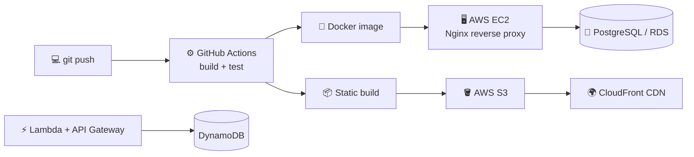

<p align="center">
  
</p>

<p align="center">
  <a href="https://github.com/JhanpolPb">
    
  </a>
</p>

<p align="center">
  <a href="https://jhanpolpb.netlify.app/"></a>
  <a href="https://www.linkedin.com/in/jhanpolpb/"></a>
  <a href="mailto:jhanpolpb840@gmail.com"></a>
</p>

---

## 🧠 About Me

```js
const jhanpol = {
  role: "Full Stack Developer",
  location: "Bogotá, Colombia 📍",
  stack: ["React", "Next.js", "Node.js", "Express", ".NET", "Laravel"],
  cloud: ["AWS EC2", "S3", "Lambda", "API Gateway", "DynamoDB", "CloudFront"],
  currentlyLearning: "AWS Serverless & System Design",
  goal: "Software Engineer in a high-impact tech company",
  motto: "Code. Learn. Build. Deploy. Repeat.",
};
```

* 🌱 Improving backend architecture and system design
* ☁️ Deploying apps on **AWS** — servers on **EC2**, static sites & assets on **S3 + CloudFront**, serverless APIs with **Lambda + API Gateway + DynamoDB**
* 🐳 Containerizing apps with **Docker** and automating deploys with **GitHub Actions**
* ⚙️ Building REST APIs and full CRUD systems with JWT auth

---

## 🛠 Tech Stack

<p align="center">
  <b>Frontend</b><br/><br/>
  
</p>

<p align="center">
  <b>Backend</b><br/><br/>
  
</p>

<p align="center">
  <b>Databases</b><br/><br/>
  
</p>

<p align="center">
  <b>Tools</b><br/><br/>
  
</p>

---

## ☁️ Cloud & Deploy

<p align="center">
  
</p>

<p align="center">
  
  
  
  
  
  
  
  
  
</p>

### 🚀 How I ship to production



---

## 🏗️ Architecture & Design Patterns

| Pattern | Use |
|---|---|
| 🧩 MVC | Backend structure |
| 🧱 Layered (N-tier) | Scalable, testable applications |
| 🔌 REST | Clean API design |
| 🔐 JWT + Roles | Authentication & authorization |
| ⚡ Serverless | Event-driven APIs on AWS Lambda |

---

## 📂 Featured Projects

<p align="center">
  <a href="https://github.com/JhanpolPb/petcareapp"></a>
  <a href="https://github.com/JhanpolPb/Authflow"></a>
  <a href="https://github.com/JhanpolPb/lambda-serverless"></a>
  <a href="https://github.com/JhanpolPb/survivor-godot"></a>
</p>

---

## 📊 GitHub Stats

<p align="center">
  
</p>

<p align="center">
  <picture>
    <source media="(prefers-color-scheme: dark)" srcset="https://raw.githubusercontent.com/JhanpolPb/JhanpolPb/output/github-contribution-grid-snake-dark.svg" />
    
  </picture>
</p>

---

<p align="center">
  <i>"Code. Learn. Build. Deploy. Repeat."</i>
</p>


